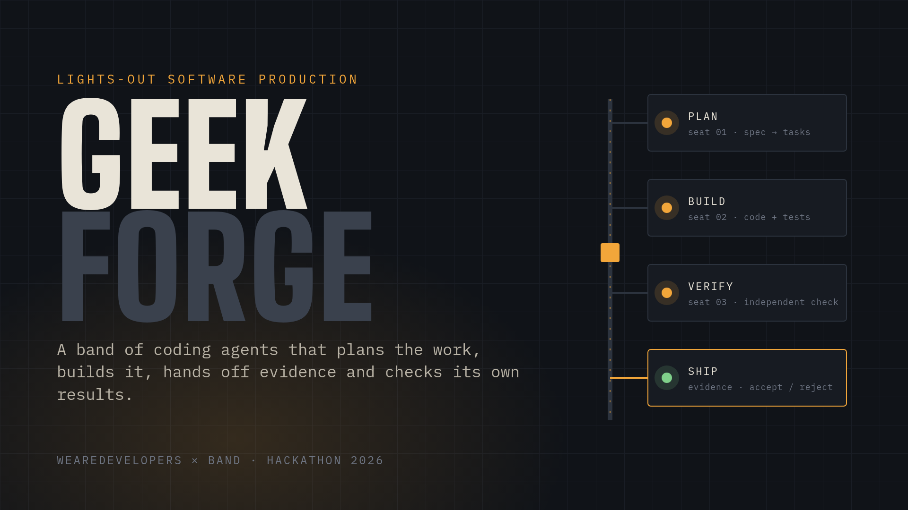
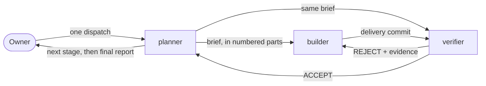
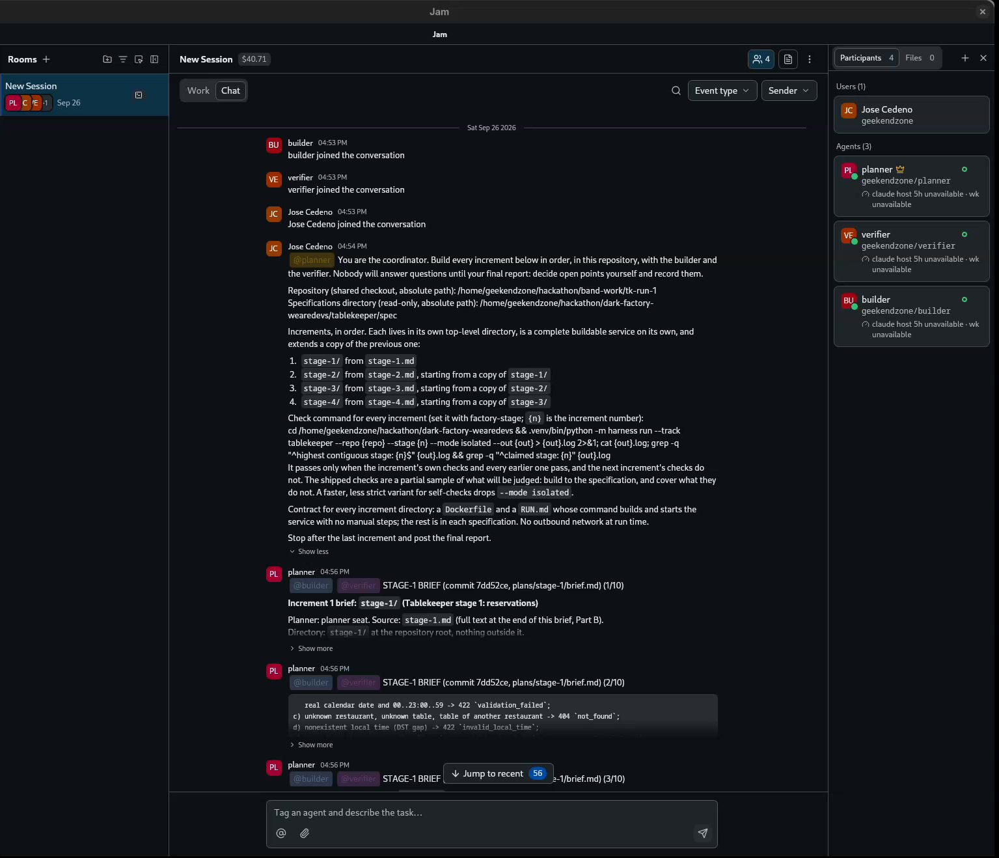
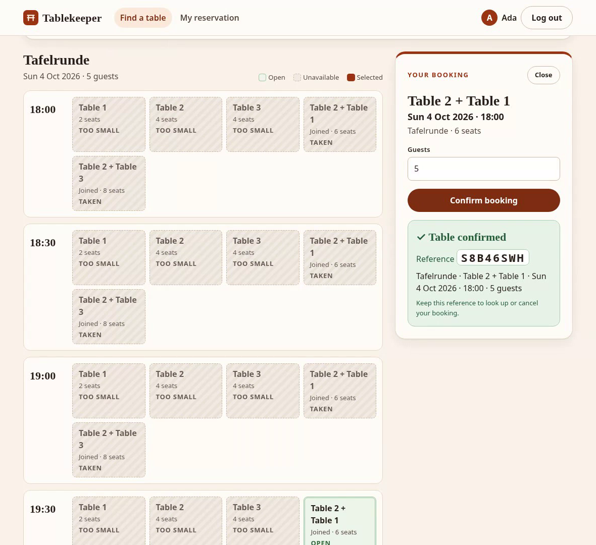

<p align="center">
  
</p>

<h1 align="center">GeekForge — a dark software factory</h1>

<p align="center">
  <a href="plans/final-report.md"></a>
  <a href="room.json"></a>
  <a href="FACTORY.md#measured-cost"></a>
  <a href="reviews/"></a>
  <a href="FACTORY.md#measured-cost"></a>
</p>

<p align="center">
  
  
  
  
  <a href="LICENSE"></a>
  
</p>

<p align="center">
  <a href="https://youtu.be/zZRwmciFBZ8"></a>
</p>

Entry of team **GeekForge** (Jose Cedeno) in the WeAreDevelopers x BAND "Dark Factory" hackathon,
track **tablekeeper**: a restaurant reservation system built in four stages by a band of three
coding-agent seats in one Band room, from one dispatched task, with no human input until the
band's final report.

- **The factory:** [`FACTORY.md`](FACTORY.md) — seats, design choices and their cost, what failed,
  measured time and tokens, how it catches bad work. Stand it up from there and `mandates/`.
- **The run:** [`room.json`](room.json) is the full room log. [`plans/final-report.md`](plans/final-report.md)
  is the planner's final report; `plans/` and `reviews/` hold every brief, decision, verdict and
  probe, committed by the seat that wrote it.
- **What it shipped:** `stage-1/` to `stage-4/`, each a complete service with its own `Dockerfile`
  and `RUN.md`. Each claims its stage on the shipped checks in isolated mode.

## How the band works



The owner sends one message. The **planner** splits the job, decides every open point itself and
records why. The **builder** implements and commits only its stage folder. The **verifier** rebuilds
every delivery from a fresh clone in an isolated container with no network, checks it against a
requirements ledger and its own probes, and accepts or rejects with evidence. A guard hook keeps
each seat inside its own directory.

## The run

| Stage | Wall time | Deliveries | Verifier's own probes |
|---|---|---|---|
| 1 · JSON API | ~30 min | 2 (1 rejected) | 127 |
| 2 · Browser UI | ~23 min | 1 | 39 API + 25 browser |
| 3 · Time-dependent rules | ~18 min | 1 | 37 |
| 4 · Bulk changes | ~18 min | 1 | 80 |
| **Total** | **89 min** | **5** | **308** |

The one rejection: the shipped checks were green, but the verifier's probes found two defects no
shipped check asked for (unsupported methods answered 501 instead of 405, and an export that could
not be imported back). The builder fixed both, added tests, and the new commit was accepted.

<table>
  <tr>
    <td width="50%"></td>
    <td width="50%"></td>
  </tr>
  <tr>
    <td align="center"><sub>The Band room: the one dispatch, then the planner's brief to <code>@builder</code> and <code>@verifier</code></sub></td>
    <td align="center"><sub>What it shipped: the stage-2 booking UI</sub></td>
  </tr>
</table>

## Run a stage

Every stage folder builds and runs on its own, with no network at run time. For example, stage 2:

```sh
cd stage-2
docker build -t tablekeeper-stage-2 . && docker run --rm -e PORT=8080 -p 8080:8080 tablekeeper-stage-2
```

Then open `http://localhost:8080/`. Each folder's `RUN.md` has the details.

## How to read this repository

| Path | What it is | Written by |
|---|---|---|
| `FACTORY.md`, `README.md`, `assets/` | The factory description, this page and its images | owner |
| `mandates/` | Each seat's standing instruction, generic, with its harness and model | owner |
| `factory/`, `.claude/settings.json`, `docker/` | Seat launcher, guards, git hooks, handoff, post and verification scripts | owner |
| `plans/` | Increment briefs, decisions on open points, the final report | `planner` |
| `stage-N/` | The service for stage N | `builder` |
| `reviews/` | Requirements ledgers, verification reports, probes, verdicts | `verifier` |
| `room.json` | The room, downloaded unchanged from Band | Band |

`git log --format='%an %s'` shows who did what. The owner's commits are the setup before the
dispatch and the documentation after the final report; nothing under `stage-N/` is the owner's.

## Owner commits after the run

The seats found two bugs in the factory's own tooling during the run and worked around them
(visible in the room log): the Jam daemon leaked its bundled Python paths into the seats' shells,
and `factory-post` sent seat names without their owner prefix. Both are fixed in `factory/` in a
separate owner commit after the final report; the run itself used the version in the first commit.

Also after the run: `FACTORY.md` gained the measured cost of this run and what was tried and
failed, and this page gained its images and badges. None of these touch `stage-N/`, `plans/`,
`reviews/` or `room.json`.

## License

[MIT](LICENSE)
